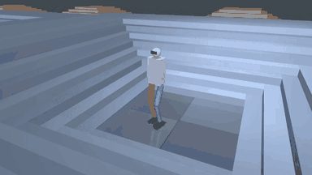
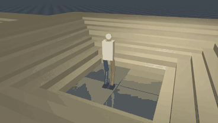
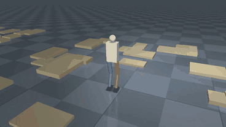

# Sim Robot Trainer

Teaches a simulated two-legged robot to walk, climb stairs and cross rough terrain with reinforcement learning (PPO) - and checks that it still works in places it was never trained in.

Thousands of robots are simulated in parallel with [MuJoCo](https://mujoco.org/), a
terrain curriculum moves them from flat ground to taller stairs and steeper slopes,
the physics is randomised so the controller cannot overfit to one simulator setup, and a
from-scratch PPO implementation in PyTorch learns the controller.

| Trained on | Never trained on | Never trained on |
| --- | --- | --- |
|  |  |  |
| regular stairs, hardest level | stairs where every step has a different height and depth | randomly scattered blocks |

*The bundled pretrained policy (`pretrained/biped.pt`). A 76-second video of eight scenarios - trained terrains, unseen terrains, shoves and an overloaded robot - is in [docs/showcase.mp4](docs/showcase.mp4).*

Built as a reinforcement learning practice project, with the main goal of understanding
how the robot model, environment design, rewards and training setup affect locomotion.

## What it does

- **12-DoF biped** (`robot/biped.xml`): hip yaw / roll / pitch, knee, ankle pitch / roll per leg, ~25 kg, PD position servos with torque limits
- **Tasks**: follow a commanded speed and heading over flat and rough ground, stairs up and down (3 cm → 16 cm steps, random tread depth) and slopes up and down (up to 22°), each in 10 curriculum levels
- **Generalisation**: training randomises friction, payload, motor strength, sensor noise and shoves; `python main.py eval` then tests the policy on 11 terrain types and 6 physical conditions that are never used in training
- **Fast**: physics for all robots is stepped by MuJoCo's multi-threaded rollout on every CPU core, the neural networks run on the GPU
- **Tools**: interactive viewer, video export, evaluation table, TensorBoard logging, resumable checkpoints

Tuned for a Ryzen 7 8845HS + RTX 4050 laptop, but it runs on anything (a GPU is optional).

## Setup

Python 3.10+ (developed and tested with Python 3.13, MuJoCo 4.0 and PyTorch 2.15).

```bash
git clone https://github.com/Usman-Siddiqi/sim-robot-trainer.git
cd sim-robot-trainer
python -m venv venv
```

Activate the virtual environment:

```bash
# Windows
venv\Scripts\activate

# macOS / Linux
source venv/bin/activate
```

Install PyTorch **with CUDA first** (a plain `pip install torch` on Windows installs the CPU-only build and the RTX 4050 would sit idle):

```bash
pip install torch --index-url https://download.pytorch.org/whl/cu126
```

Then the rest:

```bash
pip install -r requirements.txt
```

Check that everything works and see how fast your machine simulates:

```bash
python main.py bench
```

It should print `device: cuda (NVIDIA GeForce RTX 4050 ...)`. If it says `cpu`, the CUDA build of PyTorch is not installed (training still works, the PPO update is just slower).

## Usage

Watch the bundled pretrained policy climb stairs (no training needed):

```bash
python main.py play --model pretrained/biped.pt
```

Train the full task (flat + rough ground, stairs and slopes, with randomised physics):

```bash
python main.py train
```

Train on flat ground only (quick sanity check, walks after a few minutes):

```bash
python main.py train --flat --iterations 400
```

Stop any time with `Ctrl+C` (the policy is saved) and continue later:

```bash
python main.py train --resume
```

Watch your newest model, choosing terrain, difficulty level (0-9) and speed:

```bash
python main.py play --terrain stairs_up --level 7 --speed 0.6
```

`--terrain` takes the training terrains (`flat`, `rough`, `stairs_up`, `stairs_down`, `slope_up`, `slope_down`) and the held-out test terrains (`irregular_stairs_up`, `irregular_stairs_down`, `steep_stairs_up`, `steep_stairs_down`, `landing_stairs_up`, `ramp_then_stairs`, `scattered_blocks`, `waves`, `steep_slope_up`, `steep_slope_down`, `very_rough`).

In the viewer: `UP`/`DOWN` change the speed, `LEFT`/`RIGHT` turn, `BACKSPACE` restarts the episode.

Measure how good a model is, on the training terrains and on terrains / physics it has never seen:

```bash
python main.py eval
```

Use `--suite trained` or `--suite unseen` for one half only, and `--num_envs` to trade accuracy for time.

Save a video:

```bash
python main.py record --terrain stairs_up --level 7 --output stairs.mp4
```

Record the captioned eight-scenario showcase video (default: pretrained policy, `docs/showcase.mp4`):

```bash
python showcase.py --model models/<run>/model_final.pt --output my_run.mp4
```

List saved models:

```bash
python main.py list
```

Every command has `--help`, e.g. `python main.py train --help`. `play`, `eval` and `record` use the newest model in `models/` unless you pass `--model path/to/model.pt`.

## Training on the 8845HS + RTX 4050

The defaults in `config.py` are chosen for this laptop:

| Setting | Default | Why |
| --- | --- | --- |
| `num_envs` | 2048 robots | enough parallel experience per update while keeping iterations short |
| physics threads | all 16 | MuJoCo rollout thread pool, one robot batch per thread |
| networks | 512-256-128 MLPs on the GPU | one batched forward pass per control step, PPO update on ~12k-sample minibatches |
| physics / control rate | 200 Hz / 50 Hz | 4 physics steps per policy step |

What to expect (one iteration = 2048 robots x 24 steps = 49,152 simulation steps):

| Iterations | Steps | What the robots can do |
| --- | --- | --- |
| ~100 | 5 M | stay upright and walk on flat ground, still falling fairly often |
| ~150 | 7 M | cross the easiest obstacles (3-5 cm steps, gentle slopes) |
| ~300 | 15 M | mid-level obstacles (10 cm steps, 13° slopes) |
| ~400 | 20 M | the first robots finish the hardest levels |
| ~850 | 42 M | 96-98 % of obstacle tiles crossed, 3 % falls (with shoves, noise and randomised physics on) |
| ~1200 | 59 M | 99-100 % on the training terrains, and the unseen-condition results listed below |

These numbers are from an actual run of `python main.py train` with the default settings and seed. That run was done on a 4-core cloud CPU without a GPU (about 5 s per iteration, roughly two hours for 1200 iterations); the 8845HS has four times the threads and much faster cores, and the 4050 takes the PPO update off the CPU, so expect it to be several times faster. `python main.py bench` tells you the simulation speed on your machine.

The default run length is 1500 iterations. Stop early with `Ctrl+C` whenever `python main.py eval` looks good enough.

Tips:

- Plug the laptop in and use the performance power profile, otherwise the CPU is throttled hard.
- Simulation speed is CPU-bound. If you want the machine usable while training, pass `--threads 12`.
- `--num_envs 4096` gives smoother learning per iteration at twice the simulation time per iteration; VRAM is not a concern (the policy is tiny).
- Use `--device cpu` to compare, or if CUDA is not available.

## Monitoring

```bash
tensorboard --logdir logs
```

Useful curves: `train/mean_return`, `episode/terrain_level` (curriculum progress, also per terrain under `episode/level/*`), `episode/success`, `episode/fell` and the individual reward terms under `episode/reward/*`.

The console prints one line every 10 iterations (this one is from the 4-core CPU-only reference run):

```text
it  1000/1500 |  10,190 steps/s (sim  2.6s, learn  2.3s) | return   16.46 | ep len  414.7 | fell 0.02 | level 5.98 ok 0.99 | std 0.36 | lr 2e-04 | eta  55.6 min
```

`level` is the average curriculum level of the robots on obstacle tiles (0 = easiest, 9 = hardest) and `ok` is the fraction of their episodes that crossed the whole tile. Because robots that beat level 9 are sent back to a random level, a policy that has mastered everything hovers around level 6 with `ok` near 1.00. Episodes on obstacle tiles end as soon as the robot reaches the goal, so `return` and `ep len` are lower than on flat ground - that is expected.

## Pretrained policy and how well it generalises

`pretrained/biped.pt` is the result of `python main.py train` (default settings, seed 0) stopped at iteration 1200 (59 million steps). All numbers below come from `python main.py eval --model pretrained/biped.pt` (2000 robots per test, one episode each, exploration noise off). Success means crossing the whole obstacle tile, or on flat ground not falling for the full 20 s.

**Training terrains** (nominal robot): 100 % on flat, rough, stairs up, stairs down, slope up and slope down, at every level.

**Unseen terrains** - generators or parameter ranges that are never used in training:

| Terrain | What is new about it | Success | Hardest level |
| --- | --- | --- | --- |
| irregular stairs up / down | every step has its own random height and depth | 100 % / 100 % | 100 % / 100 % |
| steep stairs up / down | 25 cm treads, steps up to 18 cm (training: 26-40 cm, up to 16 cm) | 100 % / 99 % | 100 % / 89 % |
| stairs with landings | flights of three steps with 90 cm landings | 100 % | 100 % |
| ramp then stairs | a slope that turns into a staircase | 100 % | 100 % |
| scattered blocks | random blocks up to 13 cm to step on and off | 99 % | 100 % |
| waves | rolling hills, up to 35 cm peak to peak | 100 % | 100 % |
| steep slope up / down | up to 27° (training: up to 22°) | 100 % / 100 % | 100 % / 100 % |
| very rough | bumps up to 12 cm (training: up to 8 cm) | 100 % | 100 % |

**Unseen conditions** - the training terrains (all levels) with physics or commands outside the training ranges:

| Condition | Training range | Success | Fell |
| --- | --- | --- | --- |
| slippery, friction 0.4 | 0.5 - 1.25 | 94 % | 6 % |
| heavy payload, +6 kg | -1 to +3 kg | 100 % | 0 % |
| weak motors, 80 % | 90 - 110 % | 100 % | 0 % |
| hard shoves, 0.8 m/s every 3 s | 0.5 m/s every 5 s | 96 % | 4 % |
| diagonal approach, 45° | up to 29° | 100 % | 0 % |
| all at once: friction 0.45, +5 kg, 85 % motors, 0.6 m/s shoves | - | 93 % | 7 % |

The remaining failures are concentrated where physics runs out: on slippery ground the robot still does stairs and rough ground at 100 %, and slopes up to 0.28 (16°) at 97-100 %. It manages the 0.32 slope about 80 % of the time and slides on the two steepest ones (0.36 and 0.40), which are at 90-100 % of the friction coefficient of 0.4 - no controller can walk on those.

**What randomisation bought.** The first version of this project was trained without it (one staircase shape, friction 1.0, light shoves only). The same test suite on that policy: 91 % and 84 % on steep stairs / steep slopes going down (now 99 % and 100 %), 77 % under hard shoves (now 96 %), 90 % on slippery ground (now 94 %) and 84 % with everything at once (now 93 %).

**Limits.** "Unseen" here means unseen terrain shapes and physical parameters inside the same simulator. It is evidence that the policy did not memorise its training set, not a guarantee for anything arbitrary: gaps, stepping stones, steps much taller than 18 cm, or a real robot are outside what was tested.

You can also continue training from the pretrained policy: `python main.py train --resume pretrained/biped.pt`.

## How it works

**Robot.** `robot/biped.xml` is a MuJoCo model with a floating torso and two 6-joint legs. The policy outputs 12 joint position targets (offsets from a slightly crouched default pose) at 50 Hz; PD servos inside the simulator turn them into torques at 200 Hz.

**Terrain.** `terrain.py` builds a grid of 10 m tiles, one row per terrain type and one column per difficulty level: flat ground, rough ground, "pit" stairs and slopes the robot must climb out of, and "pyramid" stairs and slopes it must walk down. Stairs are built from boxes, smooth shapes from height fields, and a height raster of the whole world answers terrain queries for all robots at once. All robots share one world but each lives in its own copy of the physics state, so they never collide with each other.

**Curriculum.** A robot that crosses its whole tile is moved to the next harder level; one that falls or gets stuck is moved down. Robots that beat the hardest level are sent to a random level.

**Domain randomisation.** So that the policy does not memorise one exact simulator, training uses 32 variants of the robot with different friction (0.5-1.25), payload (-1 to +3 kg), centre of mass and motor strength (90-110 %), shoves every robot every 5 s, adds noise to every sensor reading, gives every staircase a different tread depth (26-40 cm) and approaches obstacles up to 29° off square-on. All ranges are in `DomainRandCfg`.

**Testing generalisation.** `EvalCfg` in `config.py` defines conditions that are deliberately kept out of training: terrain generators the policy never sees (irregular stairs, stairs with landings, a ramp that turns into stairs, scattered blocks, rolling waves) or parameters beyond the training range (25 cm treads with 18 cm steps, 27° slopes, 12 cm bumps), and physics outside the randomisation ranges (friction 0.4, +6 kg payload, 80 % motors, 0.8 m/s shoves, 45° approach, and several of these at once). `python main.py eval` runs all of them. If you add something from `EvalCfg` to training, it stops being a test of generalisation - add a new held-out case instead.

**Observation (105 numbers).** Base linear and angular velocity, gravity direction, the velocity command, joint positions and velocities, the previous action, a gait clock (sin/cos), and a 11x5 height scan of the terrain around the robot.

**Reward.** Track the commanded speed and heading, stay alive, step in rhythm with the gait clock and lift the swing foot clear of the next step, with penalties for wobbling, crouching, sliding feet, jerky actions, torque and joint limits. All weights are in `RewardCfg` in `config.py`.

**PPO.** `agent.py` is a compact PPO: separate actor and critic MLPs, running observation normalisation, GAE, clipped surrogate + clipped value loss, and a KL-adaptive learning rate. Timeouts are bootstrapped so "the episode ran out of time" is not treated like "the robot fell".

## Project layout

```text
sim-robot-trainer/
├── main.py           command line interface
├── config.py         every tunable number (simulation, terrain, rewards, PPO)
├── environment.py    batched MuJoCo environment (observations, rewards, resets, curriculum)
├── terrain.py        stairs generation + fast terrain height lookup
├── agent.py          actor-critic networks and the PPO algorithm
├── train.py          training loop, logging, checkpoints
├── play.py           viewer, video recording, evaluation
├── showcase.py       captioned multi-scenario demo video
├── robot/biped.xml   the robot model (MJCF)
├── pretrained/       a trained policy to try out
├── docs/             images for this README
├── models/           your checkpoints (created by training)
└── logs/             TensorBoard logs (created by training)
```

## Troubleshooting

- **`device: cpu` on a machine with an NVIDIA GPU**: reinstall PyTorch from the CUDA index (see Setup), and update the NVIDIA driver.
- **The viewer window does not open**: update your graphics driver; on Linux a desktop session is required. `python main.py record` works without a window.
- **Robots never get past low levels**: train longer, look at `episode/level/*` in TensorBoard to see which terrain is the bottleneck and at `episode/reward/*` to see which reward term dominates.
- **Changed the observation or the robot?** Old checkpoints will not fit any more; start a fresh run.

## Repository

GitHub: [Usman-Siddiqi/sim-robot-trainer](https://github.com/Usman-Siddiqi/sim-robot-trainer)
